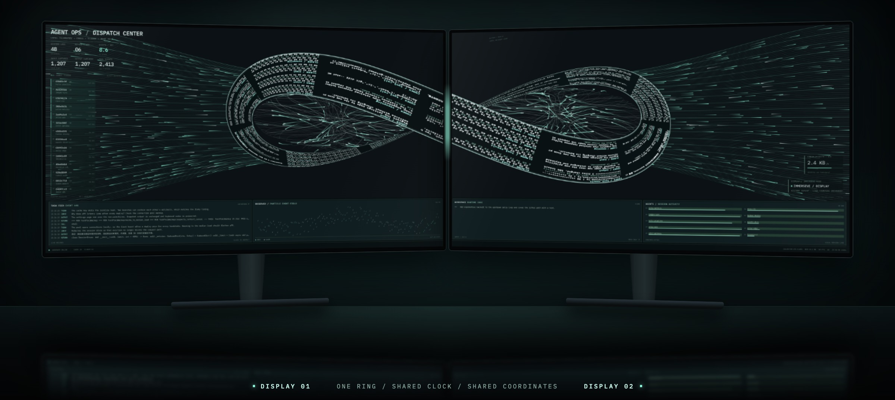
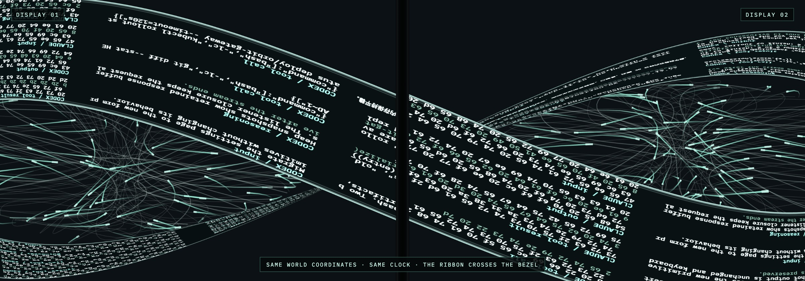
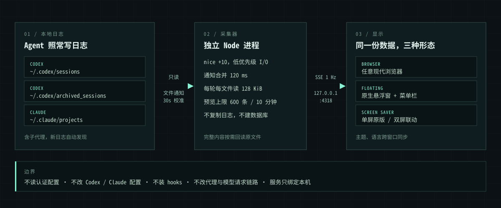

<div align="center">


# See-AgentFlow

**看见你的 AI Agent 正在做什么。**

把本机 Codex 与 Claude Code 的会话日志，变成一块实时流动的调度中心。<br>
只读、纯本地、不碰模型请求；可以悬浮在桌面，也可以铺满两台显示器。



<sub>双屏实景为合成效果，屏幕内容是 App 的真实渲染。本文所有配图均使用虚构的示例日志。</sub>

<br><br>

[核心特性](#核心特性) · [快速开始](#快速开始) · [工作原理](#工作原理) · [性能](#性能) · [隐私与边界](#隐私与边界) · [开发](#开发)

</div>

<br>

## 为什么做它

Agent 的工作发生在一屏屏滚走的终端里。同时开几个会话、再带上子代理之后，你很难一眼回答这些问题：现在谁在跑？刚调了什么工具？输出量有多大？哪个会话已经停了一小时？

See-AgentFlow 不要求你改变任何工作方式。它只读取客户端本来就会写入磁盘的日志，再把这些活动画成一块随时可以瞥一眼的屏幕：流量涌入时核心加速旋转，流量停下后缓缓滑行。屏幕上的数字和文字都来自你本机的真实记录。

## 核心特性

| 能力 | 说明 |
|---|---|
| **实时调度中心** | 弧形日志瀑布、输入 / 工具 / 输出三路流线、会话列表和四块终端面板，一屏看完全局 |
| **双屏莫比乌斯联动** | 接上第二台显示器，日志环跨过屏幕边框，共用同一套坐标和时钟 |
| **原生悬浮窗** | 无标题栏、可自由缩放、默认置顶；窗口变小时自动收起下方面板 |
| **屏保模式** | 离开座位时，整块屏幕继续流动着你本机的历史日志，并明确标注为回放 |
| **事件控制台** | 搜索最近事件，查看完整文本与原始 JSON，一键下载整个会话的原始日志 |
| **主题与语言** | 三套主题，English / 简体中文 / 繁體中文，跨浏览器、悬浮窗和屏保同步 |
| **零侵入** | 不装 hooks、不改配置、不走代理，也不读取认证信息 |
| **为常亮而设计** | 采集器独立低优先级运行；页面隐藏即停绘，15 秒后释放画布与显示缓存 |

## 一块屏幕：调度中心


- **左栏**：已发现的日志数、最近活跃会话、实时事件速率，以及按活跃度排序的会话列表。
- **中央日志环**：滚动显示真实事件的预览；右侧的十六进制块由同一条预览的 UTF-8 字节生成，不是装饰数字。
- **三路端口**：`PROMPT INGRESS`、`TOOL DISPATCH`、`RESPONSE EGRESS`，粒子量跟随实际事件和字节数变化。
- **底部四块面板**：事件流、事件分布、当前内容预览、各会话的观测字节量。

开启**沉浸模式**后，即使此刻没有请求，流线和核心也会持续运转，中央瀑布循环回放过去的本地日志，并标注 `HISTORY / REPLAY`。这些展示粒子只存在于渲染层，不进入任何事件、日志或流量统计。

## 两块屏幕：莫比乌斯联动


检测到多台显示器时，屏保会自动切换为联动布局。两块屏幕拼成一个共享画布，各自只渲染属于自己的物理区域：

- **一条环，两块屏**：放大压扁的八字莫比乌斯环，每个环瓣约占对应屏幕的一半，环带上的文字来自实际历史日志。
- **向两侧分发**：512 个文件光点从环上流向屏幕外缘，环内 208 个光点沿曲线穿行。
- **严格同步**：两屏使用同一个绝对时间周期和确定性种子，不需要进程间通信，接缝处也能对齐。
- **真实排列**：读取系统的显示器排列与偏移，支持不同尺寸的显示器。只剩一块屏幕时自动回到原版单屏布局。



不装屏保也能先看效果。启动服务后，把下面两个地址分别放到两块屏幕上全屏打开即可（以两块 1920×1080 为例）：

```text
http://127.0.0.1:4318/screensaver?width=1920&height=1080&x=0&worldWidth=3840&worldHeight=1080&count=2
http://127.0.0.1:4318/screensaver?width=1920&height=1080&x=1920&worldWidth=3840&worldHeight=1080&count=2
```

## 桌面悬浮窗


<sub>桌面环境为合成效果，窗口内容是真实渲染。</sub>

- 没有可见的标题栏，只有悬停时才会提亮的单色窗口控件。拖动上沿移动，拖动边角缩放。
- 宽度小于 1120 或高度小于 700 个点时，下方四块面板自动卸载，把空间留给动画；放大后恢复。
- 菜单栏图标的菜单提供 `Always on Top`（默认开启），选择会被记住。
- 关闭或最小化窗口会释放渲染器；屏保启动时也会自动释放，回到桌面后再恢复。
- 登录时只静默启动菜单栏，不弹窗口。需要时按 `⌘0` 打开。

## 事件控制台


点击任意事件、会话或面板上的计数即可打开。可以按来源、事件类型和会话筛选，在完整文本与 `RAW JSON` 之间切换，复制内容，或下载该会话完整的原始日志（包括没有预加载的历史部分）。内容按需从原始文件读取，界面以纯文本渲染，日志里的 HTML 和脚本不会被执行。

## 主题与语言


- **Mint Terminal**：原版薄荷绿配深青黑。
- **Silver Stream**：银白文字配淡粉光流。
- **White Signal**：深色背景上以白色流线为主，搭配不同粗细的银灰细线。

主题和语言在 Settings 中切换，自动保存并同步到所有窗口。界面文案可切换语言，你的会话名称和日志内容始终保留原文。

## 快速开始

### 浏览器（需要 Node.js 22+）

```bash
git clone https://github.com/JASON-QWeb/See-AgentFlow.git
cd See-AgentFlow
npm install
npm run build
npm start
```

然后打开 <http://127.0.0.1:4318>。macOS 上也可以直接双击项目里的 `启动看板.command`。

### macOS App（Apple Silicon，macOS 26+）

App 内含悬浮窗、屏保扩展和独立的 Node 运行环境，安装后不需要另装 Node。目前需要从源码构建（需要 Xcode 命令行工具）：

```bash
npm install
npm run build:dmg
```

产物位于 `artifacts/macos/See-AgentFlow-1.2.0-arm64.dmg`。

1. 把 App 拖入 `Applications`，弹出磁盘映像后打开一次。首次启动会自动配置用户级后台服务。
2. 在 **系统设置 → 墙纸 / 屏幕保护程序** 中选择 **Agent Ops · Continuous Link**，并设置空闲启动时间。
3. 之后登录时只会静默启动菜单栏，看板随时用 `⌘0` 打开。

> [!NOTE]
> 本地构建使用 ad-hoc 签名，尚未经过 Apple 公证。把安装包拷到另一台 Mac 时，可能需要在 **系统设置 → 隐私与安全性** 中手动允许打开。安装包不包含构建机器上的日志和设置。

卸载时运行 `python3 macos/uninstall.py`：后台服务会停止，已安装文件移入废纸篓；主题、语言偏好和原始会话日志都会保留。

## 控件一览

| 控件 | 作用 |
|---|---|
| `ALL / CODEX / CLAUDE` | 按来源筛选会话、事件与流线 |
| `IMMERSIVE` | 沉浸模式：没有请求时也持续流动，并循环回放历史日志 |
| `4K` / `STANDARD` | 4K 档使用原生像素，最高 60 FPS；标准档上限 1.25 倍像素比和 30 FPS |
| `ADAPTIVE` / `ECO ON` | 节能模式：活跃时最高 15 FPS，空闲时 6 FPS |
| 暂停按钮 | 冻结动画，采集继续运行 |
| Settings | 语言、主题、数据源状态和实时资源占用 |

**指标口径**

- `SESSION LOGS`：已发现的日志文件数，包含子代理和归档，不等于正在运行的进程数。
- `ACTIVE / 60S`：最近 60 秒内有日志活动的会话数。
- `INPUT` / `OUTPUT` / `TOOL`：从采集器本次启动开始计数，启动时预加载的历史不计入。
- `EVENTS / SEC`：最近 5 秒窗口内的平均速率。

## 工作原理



采集器自动发现并只读监听以下目录：

| 来源 | 默认路径 | 覆盖方式 |
|---|---|---|
| Codex 会话 | `~/.codex/sessions` | `AGENT_VIEW_CODEX_ROOT` 或 `CODEX_HOME` |
| Codex 归档 | `~/.codex/archived_sessions` | 同上 |
| Claude Code（含子代理） | `~/.claude/projects` | `AGENT_VIEW_CLAUDE_ROOT` 或 `CLAUDE_CONFIG_DIR` |

本地端口默认是 `4318`，可以用 `PORT` 修改。

它能解析用户输入、助手输出、工具调用与结果，以及日志里明文记录的推理摘要和上下文。

**实时粒度取决于客户端何时落盘**，通常是一条消息或一次工具事件，而不是网络层的逐 token 流式数据。尚未写入日志的 token、加密的推理内容、关闭日志的临时会话，以及其他用户或其他机器上的会话都无法观测。

## 性能

看板要长时间常亮，所以每个环节都有固定预算，而不是"尽量省"。

| 环节 | 预算 |
|---|---|
| 采集进程 | 独立 Node 进程，`nice +10`，与模型进程没有同步调用关系 |
| 读取 | 通知合并 120 ms；每轮最多 8 个文件、每个文件 128 KiB，随后让出事件循环 |
| 监听 | 文件级监听最多 512 个，其余由每 30 秒一次的轻量校准覆盖 |
| 预览缓存 | 采集器最多 600 条 / 10 分钟，界面最多 240 条 / 5 分钟，每 15 秒清理；完整内容始终留在原文件 |
| 推送 | SSE 每秒合并一次，单批最多 256 条；慢客户端断开重连，不堆积队列 |
| 粒子 | 单屏最多 760 个；双屏固定 720 个，由 GPU 按共享时间计算，不逐帧上传缓冲 |
| 帧率 | 4K 档最高 60 FPS，单画布不超过 3840×2160；普通空闲 10 FPS；ECO 15 / 6 FPS；减少动态效果时几乎静止 |
| 隐藏时 | 立即停止绘制并断开 SSE，15 秒后释放画布、WebGL 资源和显示缓存 |

**实测结果**

测试环境：Apple M4，Chromium + Metal，4K 档，画布 3840×1666，示例日志以约 8 事件/秒持续写入，每个场景采样 20 秒并多轮取平均。百分比以单个 CPU 核心为 100%。

| 场景 | 帧率 | 页面主线程 | 渲染 + GPU 进程 | JS 堆 |
|---|---|---|---|---|
| 单屏，沉浸模式 | 57–60 FPS | 约 3.7% | 约 18% | 约 4.5 MiB |
| 单屏，实时流量 | 58–60 FPS | 约 4.2% | 约 20% | 约 5 MiB |
| 双屏联动（每块屏幕） | 59–60 FPS | 约 3.2% | 约 19% | 约 3.7 MiB |

| 采集器 | 结果 |
|---|---|
| 持续约 8 事件/秒 | CPU 约 0.8%，物理内存占用约 38 MiB |
| 缓存写满 600 条、每条 256 KiB 的大记录 | 堆增量约 5 MiB，RSS 约 66 MiB |
| 一次性追加 2 万条记录（8.7 MB） | 约 2.5 秒按预算处理完，累计 CPU 约 0.35 秒 |

4K 档下，渲染进程和 GPU 进程的 RSS 相加约 450–475 MiB。这些是短时测量，不代表所有机器和负载；App 和屏保运行在 WKWebView 中，数值也会有差异。

任何看板都会占用一些资源，这里的做法是用独立进程、低优先级和固定预算限制它对你实际工作的影响。如果想再省一点，可以切到标准档或打开 ECO。

## 隐私与边界

- **只读**：不修改 Codex / Claude 的日志和配置，不读取认证信息，不安装 hooks，不改代理和模型请求链路。
- **只在本机**：服务只绑定 `127.0.0.1`，拒绝外部 Host 和跨站 Origin，运行时不依赖任何外部服务（字体、图标和脚本都打包在本地）。
- **极小的写入面**：唯一的写接口是同源的 `PUT /api/preferences`，只接受合法的主题和语言字段，保存到 `~/Library/Application Support/Agent Ops/preferences.json`。
- **不留副本**：不建数据库，不复制全量日志，只在内存里保留有界的预览。
- **会话内容属于你**：看板展示的是你自己的会话内容，公开演示或截图前请留意屏幕上的文字。

## 开发

```bash
npm run dev            # Vite 与采集器一起启动
npm test               # 采集、回放、保留策略、布局、偏好和语言表
npm run test:sites     # 静态前端托管
npm run test:installer # macOS 安装事务
```

测试会把本机已有的日志回放到临时目录中运行，结束后删除副本，不修改真实日志，也不会把会话内容提交进仓库。本机没有日志时，相应用例会明确跳过。

```text
server/            只读采集、HTTP 与 SSE
src/               React 界面
src/scene/         单屏 Canvas 渲染
src/screensaver/   双屏 WebGL 渲染与显示器布局
src/i18n/          界面语言表
macos/             原生 App、屏保扩展与打包脚本
tests/             基于本地日志回放的测试
worker/            静态前端的托管入口（本机采集仍需运行 Node 服务）
```
