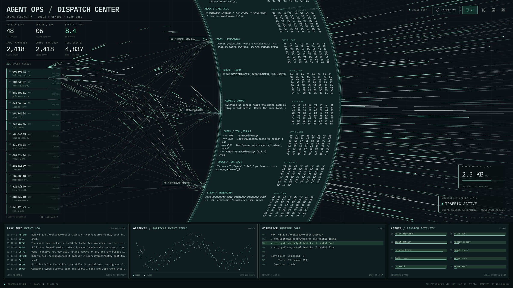
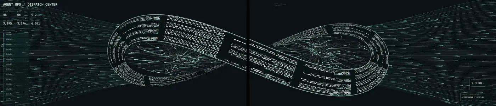
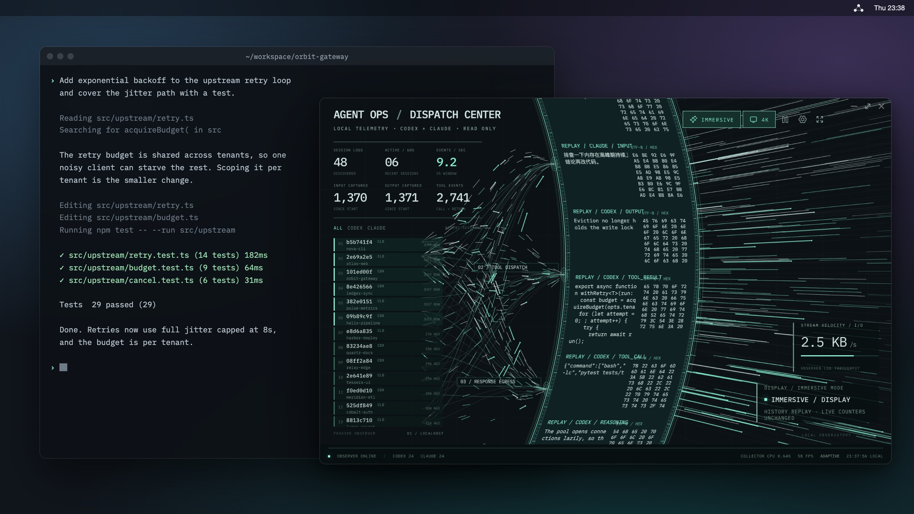
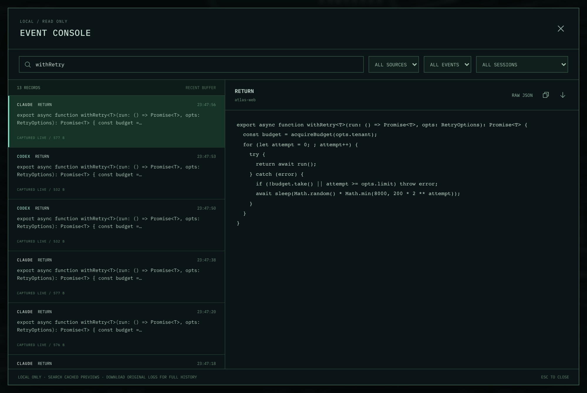
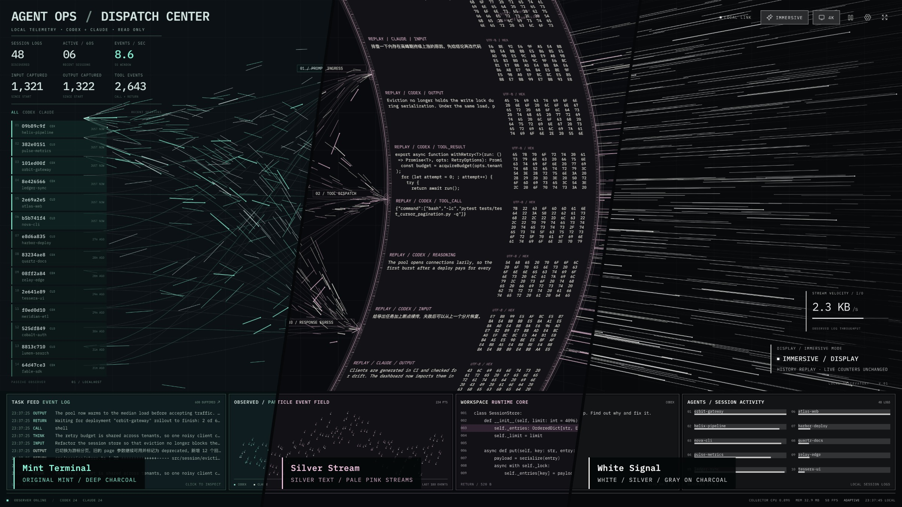

<div align="center">


# See-AgentFlow

**看见你的 AI Agent 正在做什么。**

本机 Codex 与 Claude Code 的实时调度中心。只读、纯本地、不碰模型请求，<br>
可以悬浮在桌面，也可以铺满两台显示器。

[](https://github.com/JASON-QWeb/See-AgentFlow/actions/workflows/ci.yml)
[](https://github.com/JASON-QWeb/See-AgentFlow/releases/latest)

**[下载 macOS 版](https://github.com/JASON-QWeb/See-AgentFlow/releases/latest)**


</div>

## 调度中心



会话、工具调用和输出汇成一条流动的日志环。流量涌入时核心加速，停下后缓缓滑行，屏幕上的数字和文字都来自你本机的真实记录。

## 双屏联动



接上第二台显示器，屏保会把两块屏幕拼成一个画布，日志环跨过边框，按同一个时钟流动。只剩一块屏幕时自动回到单屏布局。

## 桌面悬浮窗



无标题栏、可自由缩放、默认置顶。窗口变小时自动收起下方面板，把空间留给动画。

## 事件控制台



搜索最近事件，查看完整内容和原始 JSON，或下载整个会话的原始日志。

## 三套主题



Mint Terminal、Silver Stream、White Signal。界面支持 English、简体中文和繁體中文，你的日志始终保留原文。

## 开始使用

**macOS App**（Apple Silicon，macOS 26+）：从 [Releases](https://github.com/JASON-QWeb/See-AgentFlow/releases/latest) 下载 DMG，按发布说明安装，不需要另装 Node。

**浏览器**（Node.js 22+）：

```bash
npm install
npm run build
npm start
```

然后打开 <http://127.0.0.1:4318>。更多内容见[技术细节](docs/TECHNICAL.md)。

## 只读，且只在本机

不读取认证信息，不修改 Codex / Claude 的日志和配置，不装 hooks，不走代理。服务只绑定 `127.0.0.1`，运行时不依赖任何外部服务。

---

<sub>双屏实景和悬浮窗的桌面环境为合成效果，屏幕内容是真实渲染；所有配图均使用虚构的示例日志。</sub>
