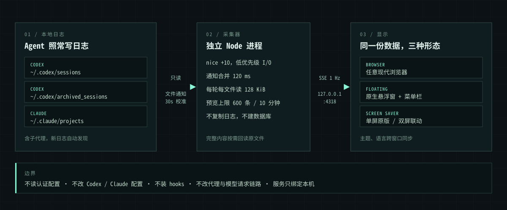

# 技术细节

产品介绍见 [README](../README.md)。

## 安装 macOS App

**Apple Silicon，macOS 26+**

App 内含悬浮窗、屏保扩展和独立的 Node 运行环境，安装后不需要另装 Node。目前需要从源码构建（需要 Xcode 命令行工具）：

```bash
npm install
AGENT_FLOW_NODE=/path/to/node-darwin-arm64/bin/node npm run build:dmg
```

打包时会把 Node 一起放进安装包，所以 `AGENT_FLOW_NODE` 要指向 [nodejs.org](https://nodejs.org/) 的官方 macOS arm64 版本。Homebrew 版依赖外部动态库，打包脚本会拒绝使用。

产物位于 `artifacts/macos/See-AgentFlow-1.2.0-arm64.dmg`。

1. 把 App 拖入 `Applications`，弹出磁盘映像后打开一次。首次启动会自动配置用户级后台服务。
2. 在 **系统设置 → 墙纸 / 屏幕保护程序** 中选择 **Agent Ops · Continuous Link**，并设置空闲启动时间。
3. 之后登录时只会静默启动菜单栏，看板随时用 `⌘0` 打开。

> [!NOTE]
> 本地构建使用 ad-hoc 签名，尚未经过 Apple 公证。把安装包拷到另一台 Mac 时，可能需要在 **系统设置 → 隐私与安全性** 中手动允许打开。安装包不包含构建机器上的日志和设置。

卸载时运行 `python3 macos/uninstall.py`：后台服务会停止，已安装文件移入废纸篓；主题、语言偏好和原始会话日志都会保留。

## 预览双屏联动

不装屏保也能先看效果。启动服务后，把下面两个地址分别放到两块屏幕上全屏打开即可（以两块 1920×1080 为例）：

```text
http://127.0.0.1:4318/screensaver?width=1920&height=1080&x=0&worldWidth=3840&worldHeight=1080&count=2
http://127.0.0.1:4318/screensaver?width=1920&height=1080&x=1920&worldWidth=3840&worldHeight=1080&count=2
```

## 控件一览

| 控件 | 作用 |
|---|---|
| `ALL / CODEX / CLAUDE` | 按来源筛选会话、事件与流线 |
| `IMMERSIVE` | 沉浸模式：没有请求时也持续流动，并循环回放历史日志 |
| `4K` / `STANDARD` | 4K 档使用原生像素，最高 60 FPS；标准档上限 1.25 倍像素比和 30 FPS |
| `ADAPTIVE` / `ECO ON` | 节能模式：活跃时最高 15 FPS，空闲时 6 FPS |
| 暂停按钮 | 冻结动画，采集继续运行 |
| Settings | 语言、主题、数据源状态和实时资源占用 |

**指标口径**

- `SESSION LOGS`：已发现的日志文件数，包含子代理和归档，不等于正在运行的进程数。
- `ACTIVE / 60S`：最近 60 秒内有日志活动的会话数。
- `INPUT` / `OUTPUT` / `TOOL`：从采集器本次启动开始计数，启动时预加载的历史不计入。
- `EVENTS / SEC`：最近 5 秒窗口内的平均速率。

## 工作原理



采集器自动发现并只读监听以下目录：

| 来源 | 默认路径 | 覆盖方式 |
|---|---|---|
| Codex 会话 | `~/.codex/sessions` | `AGENT_VIEW_CODEX_ROOT` 或 `CODEX_HOME` |
| Codex 归档 | `~/.codex/archived_sessions` | 同上 |
| Claude Code（含子代理） | `~/.claude/projects` | `AGENT_VIEW_CLAUDE_ROOT` 或 `CLAUDE_CONFIG_DIR` |

本地端口默认是 `4318`，可以用 `PORT` 修改。

它能解析用户输入、助手输出、工具调用与结果，以及日志里明文记录的推理摘要和上下文。

**实时粒度取决于客户端何时落盘**，通常是一条消息或一次工具事件，而不是网络层的逐 token 流式数据。尚未写入日志的 token、加密的推理内容、关闭日志的临时会话，以及其他用户或其他机器上的会话都无法观测。

## 性能

看板要长时间常亮，所以每个环节都有固定预算，而不是"尽量省"。

| 环节 | 预算 |
|---|---|
| 采集进程 | 独立 Node 进程，`nice +10`，与模型进程没有同步调用关系 |
| 读取 | 通知合并 120 ms；每轮最多 8 个文件、每个文件 128 KiB，随后让出事件循环 |
| 监听 | 文件级监听最多 512 个，其余由每 30 秒一次的轻量校准覆盖 |
| 预览缓存 | 采集器最多 600 条 / 10 分钟，界面最多 240 条 / 5 分钟，每 15 秒清理；完整内容始终留在原文件 |
| 推送 | SSE 每秒合并一次，单批最多 256 条；慢客户端断开重连，不堆积队列 |
| 粒子 | 单屏最多 760 个；双屏固定 720 个，由 GPU 按共享时间计算，不逐帧上传缓冲 |
| 帧率 | 4K 档最高 60 FPS，单画布不超过 3840×2160；普通空闲 10 FPS；ECO 15 / 6 FPS；减少动态效果时几乎静止 |
| 隐藏时 | 立即停止绘制并断开 SSE，15 秒后释放画布、WebGL 资源和显示缓存 |

**实测结果**

测试环境：Apple M4，Chromium + Metal，4K 档，画布 3840×1666，示例日志以约 8 事件/秒持续写入，每个场景采样 20 秒并多轮取平均。百分比以单个 CPU 核心为 100%。

| 场景 | 帧率 | 页面主线程 | 渲染 + GPU 进程 | JS 堆 |
|---|---|---|---|---|
| 单屏，沉浸模式 | 57–60 FPS | 约 3.7% | 约 18% | 约 4.5 MiB |
| 单屏，实时流量 | 58–60 FPS | 约 4.2% | 约 20% | 约 5 MiB |
| 双屏联动（每块屏幕） | 59–60 FPS | 约 3.2% | 约 19% | 约 3.7 MiB |

| 采集器 | 结果 |
|---|---|
| 持续约 8 事件/秒 | CPU 约 0.8%，物理内存占用约 38 MiB |
| 缓存写满 600 条、每条 256 KiB 的大记录 | 堆增量约 5 MiB，RSS 约 66 MiB |
| 一次性追加 2 万条记录（8.7 MB） | 约 2.5 秒按预算处理完，累计 CPU 约 0.35 秒 |

4K 档下，渲染进程和 GPU 进程的 RSS 相加约 450–475 MiB。这些是短时测量，不代表所有机器和负载；App 和屏保运行在 WKWebView 中，数值也会有差异。

任何看板都会占用一些资源，这里的做法是用独立进程、低优先级和固定预算限制它对你实际工作的影响。如果想再省一点，可以切到标准档或打开 ECO。

## 隐私与边界

- **只读**：不修改 Codex / Claude 的日志和配置，不读取认证信息，不安装 hooks，不改代理和模型请求链路。
- **只在本机**：服务只绑定 `127.0.0.1`，拒绝外部 Host 和跨站 Origin，运行时不依赖任何外部服务（字体、图标和脚本都打包在本地）。
- **极小的写入面**：唯一的写接口是同源的 `PUT /api/preferences`，只接受合法的主题和语言字段，保存到 `~/Library/Application Support/Agent Ops/preferences.json`。
- **不留副本**：不建数据库，不复制全量日志，只在内存里保留有界的预览。
- **会话内容属于你**：看板展示的是你自己的会话内容，公开演示或截图前请留意屏幕上的文字。

## 开发

```bash
npm run dev            # Vite 与采集器一起启动
npm test               # 采集、回放、保留策略、布局、偏好和语言表
npm run test:sites     # 静态前端托管
npm run test:installer # macOS 安装事务
```

测试会把本机已有的日志回放到临时目录中运行，结束后删除副本，不修改真实日志，也不会把会话内容提交进仓库。本机没有日志时，相应用例会明确跳过。

```text
server/            只读采集、HTTP 与 SSE
src/               React 界面
src/scene/         单屏 Canvas 渲染
src/screensaver/   双屏 WebGL 渲染与显示器布局
src/i18n/          界面语言表
macos/             原生 App、屏保扩展与打包脚本
tests/             基于本地日志回放的测试
worker/            静态前端的托管入口（本机采集仍需运行 Node 服务）
```
