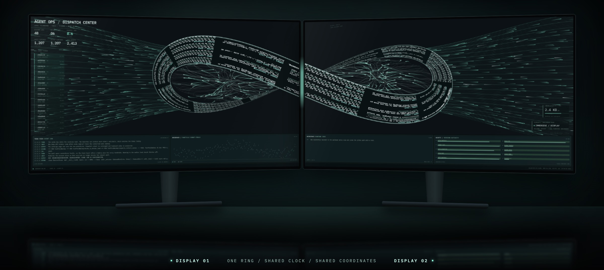

See-AgentFlow 的首个公开版本：把本机 Codex 与 Claude Code 的会话日志，变成一块实时流动的调度中心。只读、纯本地、不碰模型请求。



## 亮点

- **实时调度中心**：日志瀑布、输入 / 工具 / 输出三路流线、会话列表和四块终端面板。
- **双屏莫比乌斯联动**：接上第二台显示器，日志环跨过边框，按同一个时钟流动。
- **原生悬浮窗与屏保**：无标题栏、可自由缩放、默认置顶；离开座位时循环回放本地历史，并明确标注。
- **事件控制台**：搜索最近事件，查看完整内容和原始 JSON，下载整个会话的原始日志。
- **三套主题和三种语言**：Mint Terminal、Silver Stream、White Signal；English、简体中文、繁體中文。
- **全新黑白图标**：App、菜单栏和网页使用同一条莫比乌斯环。

## 安装

需要 Apple Silicon 和 macOS 26 或更高版本，不需要另装 Node。

1. 下载下方的 DMG，把 App 拖入 `Applications`，然后弹出磁盘映像。
2. 这个版本使用 ad-hoc 签名，尚未经过 Apple 公证，macOS 会阻止直接打开。在终端运行一次：

   ```bash
   xattr -dr com.apple.quarantine "/Applications/Agent Ops Screen Saver.app"
   ```

3. 打开 App 一次，它会配置用户级后台服务。之后登录时只静默启动菜单栏，按 `⌘0` 打开悬浮窗。
4. 如果要用屏保，在 **系统设置 → 墙纸 / 屏幕保护程序** 中选择 **Agent Ops · Continuous Link**。

下载后可以校验文件：

```bash
shasum -a 256 -c See-AgentFlow-1.2.0-arm64.dmg.sha256
```

## 隐私

不读取认证信息，不修改 Codex / Claude 的日志和配置，不装 hooks，不走代理。服务只绑定 `127.0.0.1`，安装包不包含任何日志或个人设置。

更多信息见[技术细节](https://github.com/JASON-QWeb/See-AgentFlow/blob/v1.2.0/docs/TECHNICAL.md)。
